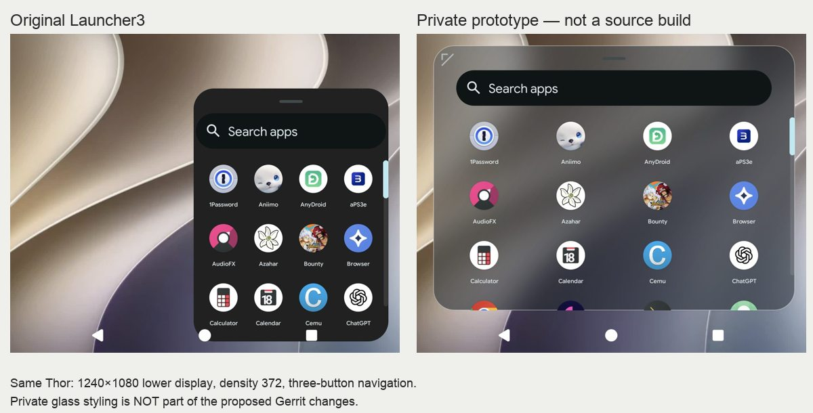

# Secondary-display drawer: Thor review proposal

AI-assisted code and evidence preparation on behalf of Kevin Howe. This is a source proposal and private prototype comparison, not an official LineageOS feature or a verified platform build.

## Review links

- [Gerrit 509291: size secondary drawer within insets](https://review.lineageos.org/c/LineageOS/android_packages_apps_Launcher3/+/509291) — WIP.
- [Gerrit 509292: allow secondary drawer resizing](https://review.lineageos.org/c/LineageOS/android_packages_apps_Launcher3/+/509292) — WIP, depends on 509291.

The series starts directly from `lineage-24.0` commit `818f72b` and does **not** depend on the separate bottom-screen app-launch shortcut review 508976.

## Problem and comparison

[Original launcher](images/stock.jpg) · [Private prototype](images/prototype.jpg)

The owner finds the narrow, fixed-size secondary app panel difficult to browse on the Thor. Much of the lower screen remains unused. In the captured configuration, the panel also occupies the same region as the Android navigation buttons; the buttons remain visible above it, but the panel/content does not reserve their area. This is an overlap, not evidence that the system buttons disappear or cannot be pressed.

| Measurement | Original installed Launcher3 | Private prototype, saved size |
|---|---:|---:|
| Physical lower display | 1240 × 1080 px | Same |
| Logical density | 372 dpi | Same |
| Panel left / top | 584 / 238 px | 53 / 101 px |
| Panel right / bottom | 1204 / 1044 px | 1204 / 945 px |
| Panel width | 620 px (50% of display) | 1151 px (92.8%) |
| Navigation area top | y = 968 px | y = 968 px |
| Panel/navigation intersection | 76 px vertically | None; 23 px gap |
| User sizing | No grip in original UI | Upper-left grip, saved ratios |

The new layout provides more room between columns and separates the app surface from system navigation. Both examples use four columns; this is not a claim of larger icon bitmaps or more fully visible rows in every size. Search, scrolling, icon labels, and app launching remain native Launcher3 responsibilities. No task-completion or usability study has been performed.

## Proposed upstream scope

1. Measure the secondary panel using available display space rather than capping height and width to the icon-column count. The initial proposal uses 94% of usable width and 88% of usable height; these defaults are open to maintainer direction.
2. Respect system-bar and cutout insets with a 10 dp gap. Keep drawing inside the measured panel.
3. Add touch resizing, bounded to the usable area, with saved width/height ratios per logical display.
4. Propose accessible enlarge, shrink, and reset actions as alternatives to dragging. TalkBack reachability still needs verification.

The code is generic to the secondary launcher, not a Thor product-name check. That also means external-display regressions must be tested before merge.

## What is intentionally not proposed

The screenshots show a separate private package derived from the installed Launcher3 APK. Its frosted Golden Gate background and brown launcher button are private styling. The source series retains the normal Lineage resources and does **not** include:

- Glass/theme assets, wallpaper content, or dark-icon experiments.
- A repackaged APK, private signing material, or APK disassembly.
- Hidden-API bypasses, global security changes, privileged installation workarounds, or the framework secondary-home configuration overlay used to route the private test app.
- Changes to the primary home screen, stock launcher data, wallpaper service, fans, clocks, or LEDs.

The source port is not byte-identical to the prototype. It uses the native source classes and adds explicit system-bar/cutout handling and proposed accessibility actions. Prototype screenshots demonstrate the interaction direction; they do not certify the exact source series.

## Evidence and reproduction environment

Captured October 18, 2026 on `odin2thor`, `24.0-20261013-NIGHTLY-odin2thor`, Android 17, kernel `5.15.220-g15aa73823d0c`. Original Launcher3 APK was retained unchanged, and its own secondary activity was opened for the baseline capture. The private package was then used for the prototype capture. The same lower screen and density were used.

This device is modified: Google apps, a private live wallpaper, a private secondary launcher, a secondary-home configuration overlay, and overlayfs changes are present. It is not a pristine official-ROM test. That is disclosed rather than submitted as a clean bug report to the official issue tracker.

Baseline steps: open the original secondary Launcher3 activity on the lower display; tap its apps button; observe the panel width and lower edge relative to Back/Home/Overview. Source inspection shows the original column-count-based cap in `SecondaryDragLayer.onMeasure`.

The published images crop the status strip and contain only the launcher/app inventory. No account pages, raw logs, network addresses, device serials, keys, or private app databases are published. Original captures and full dumps remain local. App names/icons visible in the launcher are intentionally part of this comparison.

## Validation status

- **Verified on device, private prototype:** native drawer opens; resize gesture changes measured bounds and saves ratios; the panel ends above three-button navigation; current glass layout and original full-color icons are visible. Owner confirmed the launcher appearance.
- **Verified for source controller:** the exact controller compiled from this branch ran in a separate test-only APK on the real Thor lower display. The reproducible script passed 31 checks on its first run and 33 after a forced test-process restart, including persistence after disk writes complete, resize bounds, cancellation, direct enlarge/shrink/reset methods, and ordinary-touch pass-through. See [test source and results](controller-checks/README.md). This does **not** validate the complete Launcher3 target, native accessibility action wiring, or TalkBack.
- **Not yet verified:** full `Launcher3QuickStep` platform build from this series, installation of that build, exact source-series reboot persistence, TalkBack/custom action reachability, keyboard focus/IME transitions, drag-and-drop/pinning, external displays, gesture navigation, rotations/cutouts, RTL layouts, multi-user behavior, and density changes.
- **Known private-test incident:** the lower display was black immediately after a test reboot and recovered after unlock; the upper video wallpaper also required recovery. This series does not claim to fix those incidents or attribute them to the official drawer.

## Before requesting merge

Build and install the source series in a complete LineageOS tree. Repeat the comparisons without private routing/theme modifications. Exercise the outstanding cases above, add regression coverage for insets and persisted size bounds, and resolve review feedback. Keep the reviews WIP until those gates pass. The geometry fix can be considered independently if maintainers prefer not to add user resizing.

Feedback requested: is an expanded secondary panel with safe navigation insets appropriate upstream, and should resizing be part of the native secondary launcher or remain a private customization? The private glass styling is not a requirement for accepting the functional changes.

## Full-build blocker on the available host

As of October 18, the available host is an ARM64 Mac with 16 GiB free internally; the backup SSD has 289 GiB free. No usable x86-64 Linux VM or running review CI build was found. Current [AOSP requirements](https://source.android.com/docs/setup/start/requirements) specify x86-64 Linux, at least 400 GB free storage, and 64 GB RAM. A complete supported build environment must be provided before these reviews can be taken out of WIP. No backup data was removed to make room and no paid host was provisioned.
